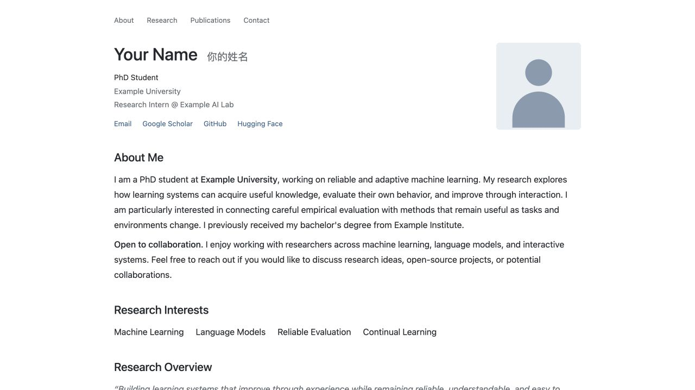

# 简洁学术主页模板

单栏布局，保留完整的个人介绍、研究兴趣与方向说明，并提供论文筛选、完整动态页、机构 logo 和论文项目页。使用 HTML、CSS、JavaScript 和 JSON，无需构建。

[在线演示](https://yofuria.github.io/academic-homepage-template/) · [使用模板](https://github.com/Yofuria/academic-homepage-template/generate) · [English](../README.md)

## 快速开始

1. 点击仓库的 **Use this template → Create a new repository**。
2. 个人主页仓库命名为 **你的用户名.github.io**；项目网站可以使用任意仓库名称。
3. 按下方文件说明替换示例信息。
4. 在 **Settings → Pages** 中选择 **Deploy from a branch**，设置为 **main / (root)**。
5. 打开 GitHub 显示的 Pages 地址。

四个网页共用样式和脚本，同时支持域名根目录与仓库子路径部署。

## 修改哪些文件

| 文件 | 内容 |
| --- | --- |
| [data/site.json](../data/site.json) | 姓名、可选中文名、身份、单位、邮箱、位置、头像、社交链接及主页描述 |
| [index.html](../index.html) | 简介、研究兴趣与方向、项目、教育、经历和学术服务 |
| [data/publications.json](../data/publications.json) | 论文标题、作者、会议、年份、资源链接、一作标记和首页可见性 |
| [data/news.json](../data/news.json) | 按时间从新到旧排列的简短动态；首页显示三条，完整动态页显示全部 |
| [projects/example/index.html](../projects/example/index.html) | 项目标题、作者、示意图、摘要、方法介绍和 BibTeX |
| [homepage.css](../homepage.css) | 统一的颜色、字号、间距和响应式布局 |
| [assets](../assets) | 头像、Tab 图标、机构 logo 和项目图 |

浏览器标题和各页页脚中的姓名会读取统一配置。简介与履历在首页 HTML 中编辑；论文作者及项目引用分别在对应的内容文件中编辑。

资源路径使用 **assets/portrait.svg**、**projects/example/** 这样的仓库相对路径，让模板也能部署在 GitHub Pages 的项目子路径下。

### 论文配置

- **type**：accepted 或 preprint。
- **isFirstAuthor**：第一作者、共同第一作者填 true，用于一作筛选。
- **showOnHomepage**：填 false 时只在完整论文列表中显示。
- **featuredOrder**：可选的首页优先级，数值越小越靠前。
- **venueFullName / venueShortName**：可选的会议名称显示覆盖，用于指定 workshop 等名称，例如“Example Research Workshop · NeurIPS'26”。
- **tags**：论文、代码、项目等资源链接。链接填 **#** 时显示为不可点击的占位文本。

完整论文列表按年份分组。演示中的论文、动态、单位和项目均为示例，使用时替换为你自己的内容。

### 头像与 logo

桌面端的照片会自动与左侧信息块等高；手机端放在姓名和身份右侧，单位与链接排列在下方。替换占位素材后，更新对应的图片路径即可。

## 本地预览与检查

在仓库目录执行：

    python3 tools/check_site.py
    python3 -m http.server 8000 --bind 127.0.0.1

打开 [http://127.0.0.1:8000/](http://127.0.0.1:8000/)。使用 HTTP 服务预览，浏览器才能读取 JSON 数据。

发布前检查主页、两个列表页、示例项目页、论文筛选及手机布局。修改共用 CSS 或 JavaScript 后，同步更新四个 HTML 文件引用中的版本号。

## 隐私与依赖

模板使用原创 SVG 占位图和通用示例内容，默认不启用 Analytics，不包含个人照片、真实机构品牌素材或引用爬虫凭证。前端无需安装 JavaScript 依赖。

## 致谢与许可

基于 [Yofuria.github.io](https://yofuria.github.io/) 与 [AcaNova-X](https://github.com/yihangtao/AcaNova-X) 整理，并保留对 [AcadHomepage](https://github.com/RayeRen/acad-homepage.github.io/)、[Minimal Mistakes](https://github.com/mmistakes/minimal-mistakes) 和 [Academic Pages](https://github.com/academicpages/academicpages.github.io) 的上游致谢。

使用 [MIT License](../LICENSE)，保留原有 Yi Ren 版权声明。
